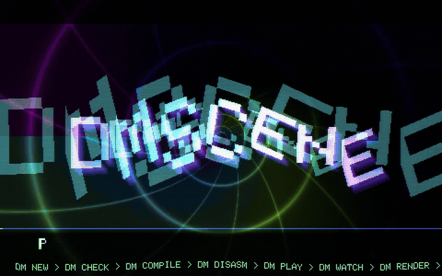
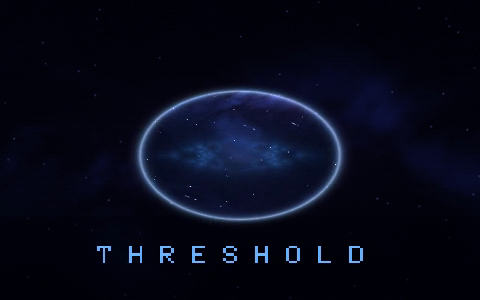

```
      _
   __| |_ __ ___  ___  ___ ___ _ __   ___
  / _` | '_ ` _ \/ __|/ __/ _ \ '_ \ / _ \
 | (_| | | | | | \__ \ (_|  __/ | | |  __/
  \__,_|_| |_| |_|___/\___\___|_| |_|\___|  v4
  ▀▄▀▄ one VM, six programs: inst  chan  master  frame  pixel  post
  ▄▀▄▀ text -> byte-packed module -> tracker + fractals
```

# dmscene

A composable demoscene engine in pure C99 with no third-party libraries.
Write the instruments, tracker score, visuals and effects in one text file.

[Demo](#demo) · [Build and run](#build-and-run) · [How it works](#how-it-works) · [CLI](#cli) · [Demos](#demos) · [Text format](#the-text-format-dmt)

```
.dmt text  --dm compile-->  .dms module  --dm play-->    truecolor terminal + audio
                                       --dm render-->  MP4 / PNG / WAV
```

## Demo

A 43-second demo with synth music, fractals and animated text, generated from
[one .dmt file](demos/showcase.dmt).

<p align="center">
  <a href="demos/showcase.dmt">
    
  </a>
</p>

The preview is silent. Run `make run` to hear the music, or
[open the demo source](demos/showcase.dmt).

```sh
make
make run                                  # live demo in your terminal; q quits
./dm watch demos/showcase.dmt              # edit the score or visuals live
make showcase                             # full 960x600 / 30 fps MP4 + stereo WAV
```

The render writes `build/video/showcase.mp4` and `build/audio/showcase.wav`.
Install ffmpeg for MP4 export. `make showcase SIZE=1280x800` renders a larger
copy; `make showcase-preview` regenerates the animated README highlights.
Use `make run DEMO=demos/pulse.dmt` to launch another demo.

| time | chapter | on screen |
|------|---------|-----------|
| 0:00.0 | Boot the rave | recursive logo copies rush toward the camera; bouncing extruded letters |
| 0:05.3 | Compile / ignite | log-polar byte vortex; each letter flips and twists independently |
| 0:10.7 | The code is the beat | rotating eight-channel audio rotor driven by actual channel levels |
| 0:16.0 | Zoom until tomorrow | staggered Mandelbrot zooms, recursive rings and liquid type |
| 0:21.3 | Through the donut | forward flight through a repeating chain of twisted tori |
| 0:26.6 | Feed it back | the logo melts into the real rotating/zooming previous-frame buffer |
| 0:32.0 | Export the damage | accelerating hyperspace rails, tiled walls, streaks and warped type |
| 0:37.3 | One VM. Full send. | zooming kaleidoscopic field and independently flipping finale letters |

The demo uses all six VM program kinds, eight pixel programs, samples,
envelopes and timeline events. Each chapter lasts four bars at 180 BPM.

## Build and run

```sh
make                          # build dm on macOS or Linux
./dm play demos/showcase.dmt   # compile in memory and play; q quits
./dm play demos/pulse.dmt      # try another score
./dm new mydemo               # create a minimal mydemo.dmt
./dm watch mydemo.dmt          # play and recompile on save
make demos                    # compile demos/*.dmt into build/modules/*.dms
make test                     # engine, compiler, audio and all demos
```

Building needs a C99 compiler and make. Playback uses a truecolor terminal
and CoreAudio on macOS, or the configured audio pipe on Linux (`aplay` by
default). Offline rendering needs no terminal or audio device:

```sh
mkdir -p build/video build/audio build/frames/pulse
./dm render demos/pulse.dmt --mp4 build/video/pulse.mp4 --wav build/audio/pulse.wav --seconds 30 --size 960x600 --fps 30
./dm render demos/pulse.dmt --seconds 16 --png build/frames/pulse --wav build/audio/pulse.wav --size 640x400
make videos SECONDS=30 SIZE=960x600    # build/video/*.mp4 + build/audio/*.wav
```

`--mp4` pipes raw RGB frames into `ffmpeg` (libx264 crf 18, yuv420p, AAC 192k,
faststart). Without ffmpeg on `PATH` it writes `FILE.frames/` and `FILE.wav` and
prints the command that finishes the job. The pixel loop runs on all cores.

Dependencies: libc, libm, pthreads. Audio is AudioToolbox (a C API) on macOS and
a pipe to `aplay` elsewhere. Video is ANSI truecolor using `▀` for two pixels per
cell; use a fast terminal (Ghostty, iTerm2, kitty, WezTerm). `ffmpeg` is optional
and only used by `--mp4`.

Generated files stay grouped under `build/`: `obj/` for object files,
`modules/` for compiled demos, `video/` for MP4s, `audio/` for WAVs,
and `tests/` for test executables. `make videos` writes matching video/audio
pairs. Put PNG sequences in `build/frames/` and image previews in
`build/images/`. Test scratch files are removed on exit. `make clean` removes
generated build output and the `dm` binary.

## How it works

One small stack VM runs every programmable part of a demo. Six program kinds
share one bytecode segment inside a byte-packed `.dms` module:

| program  | runs                          | reads                                        | writes                     |
|----------|-------------------------------|----------------------------------------------|----------------------------|
| `inst`   | per sample per voice          | `ph freq t rel vel note p0..p3` + clock      | `out(sample)`              |
| `chan N` | per sample on channel N's sum | `x` + clock                                  | `out(sample)`              |
| `master` | per sample on the stereo mix  | `l r` + clock                                | `out(l, r)`                |
| `frame`  | once per video frame          | clock, `trig(c) vel(c) note(c) cenv(c)`      | uniforms, `select(scene)`  |
| `pixel`  | per pixel (one of up to 8)    | `x y u v`, uniforms, clock, `prev`           | colour accumulator         |
| `post`   | per pixel after `pixel`       | the finished frame via `tap(dx, dy)`         | colour accumulator         |

An XM-style tracker (patterns, order list, effects) drives the voices and
publishes its clock to the visual programs. Sync is sample-accurate: the video
thread owns a second sequencer instance seeked to the sample position CoreAudio
reports as currently audible. The VM has counted loops and structured branches;
the loader verifies their targets and stack joins before running a program.

## CLI

```
dm COMMAND file [options]

  compile IN [-o OUT.dms] [--disasm]   text -> byte-packed module (default OUT: IN with .dms)
  check   IN                           compile and verify only, write nothing
  disasm  IN                           print every program's bytecode
  play    IN [play options]            terminal + audio (IN may be .dmt or .dms)
  watch   IN [play options]            play, recompiling whenever the .dmt changes
  render  IN --mp4 F | --png DIR | --wav F [--seconds S] [--size WxH] [--fps N] [--start S]
  new     NAME                         write NAME.dmt, a minimal starting point

play options:
  --fps N       target frame rate (default 30)      --size WxH   force framebuffer size
  --mute        no audio, wall-clock visuals         --start S    start S seconds in
  --solo C      hear only channel C                  --threads N  pixel worker threads
```

`dm --help` (or `dm -h`) prints the banner and command reference. In the
player, `q` or `Esc` quits, `1`..`8` toggle channel mutes, `0` unmutes all, and
`r` forces a reload in watch mode. The status line shows title, bpm, order,
row, beat, resolution, fps, channel flags
and the last reload result or compile error. `watch` swaps the new module in at
the same sample position; uniforms and feedback buffers restart.

Environment: `DM_THREADS` worker count, `DM_AUDIO_CMD` player command for the
pipe backend (default `aplay -q -t raw -f S16_LE -r 44100 -c 2`),
`DM_AUDIO_LATENCY` pipe latency estimate in ms (default 250).

## Layout

```
include/dm_ops.h    instruction set (X-macro: one table drives VM, compiler, verifier, disassembler)
include/dm.h        public API, limits, all structs
include/dm_banner.h --help header shared by the tools
src/dm_vm.c         VM dispatch, intrinsics, loops, branches, verifier, disassembler
src/dm_font.c       5x7 ASCII font for glyph()
src/dm_seq.c        tracker: rows, ticks, effects, beat clock, timeline lookup (no audio; reused as the video clock)
src/dm_synth.c      32-voice pool with NNA, chan fx programs, level followers, master program, player loop
src/dm_module.c     .dms writer/reader, palette LUTs, module verification
src/dm_compile.c    .dmt text -> module (line-oriented top level, Pratt expression parser, fn inlining, WAV/PPM loaders)
src/dm_scene.c      frame, selected pixel program, post pass; worker threads; previous-frame buffer; ordered dither
src/dm_io.c         PNG (stored deflate, own CRC/Adler), PPM, WAV writers
src/dm_term.c       terminal blitter with nearest-neighbour scaling, raw keys, timing
src/dm_audio.c      AudioQueue backend / pipe backend
tools/dm.c          the CLI
demos/*.dmt         the demos (table below); demos/assets holds WAV samples and PPM textures
tests/run.sh        compile, round-trip, determinism, audio, errors, features and every demo
tests/synth-voices.c voice ownership, held notes, NNA tails, slot reuse and PCM isolation
tests/showcase-gates.c bass/lead gate durations across breaks and song loops
tests/branch-texture.c branch execution and verification, PPM sampling and module round trip
art/               README artwork and animated demo highlights
```

## Demos

| file | bpm | music | visual |
|------|-----|-------|--------|
| `showcase.dmt` | 180 | **ONE VM / NO SLEEP**: fast chip/rave, four-on-the-floor kick, offbeat bass, rolling hats, bell replies, octave-up pulse/FM drop | recursive word zooms, kinetic/flipping glyphs, live audio rotor, deep Mandelbrot zooms, torus fly-through, text feedback, hyperspace, kaleidoscopic finale; moving CLI tour |
| `pulse.dmt` | 128 | house: FM kick, FM bass, pluck arps, pad, stereo echo | Julia set whose `c` orbits the cardioid; kaleidoscope fold; orbit-trap glow on the arp |
| `acid.dmt` | 140 | 303 line (`svf` + tone portamento + accents), claps, stabs | Mandelbrot seahorse valley breathing in and out, feedback trails |
| `kaleido.dmt` | 150 | chiptune: pulse arps via `0xy`, 25% pulse, bitcrushed triangle, noise drums | kaleidoscopic IFS through a 3/5/7/9-fold polar mirror |
| `ship.dmt` | 174 | drum & bass: two-step break, reese bass, filtered stabs | burning ship, mirrored, fire palette, snare strobes |
| `newton.dmt` | 90 | ambient: evolving pad, FM bells, sub, filtered air | Newton fractal for z³-1, three shaded basins, slow drift |
| `tunnel.dmt` | 138 | trance: gated supersaw, offbeat bass, claps | perspective tunnel with voronoi wall tiles and kick rings |
| `plasma.dmt` | 160 | NES: 50%/25% pulses, triangle bass, 1-bit noise drums | low-res sine plasma, ordered dither, 7-colour hard palette |
| `sierpinski.dmt` | 132 | minimal techno: kick, rumble, clicks, bleeps into delay | folding KIFS geometry, inverted flash every four bars |
| `feedback.dmt` | 75 | dub: 808 kick, rim, skank chords, long filtered delays | tiny Julia seed smeared through a rotating zoom feedback loop |
| `mandel.dmt` | 85 | swung lo-fi hip-hop (`F07`/`F05` swing), rhodes FM, vinyl crackle in `master` | flight between three Mandelbrot boundary points, star traps, grain |
| `cells.dmt` | 128 | electro funk: slap bass with `1xx`/`2xx` bends, zap lead, claps | domain-warped voronoi cells pulsing on their own beat phase |
| `hakkuh.dmt` | 180 | Rotterdam hardcore: overdriven 909 kick as bassline, three-saw hoover riff, square lead hook, orchestra hits, kick rolls | black/white/red Julia bands racing on the beat, shake and inversion strobe on every kick, melting feedback, a flame-haired wizard with fists up built from `fn` SDF helpers. **Strobes.** |
| `lightwall.dmt` | 100 | Tron: slow heavy kick, 8th-note grid pulse, unison brass, driven 16th arp, PWM lead, long reverb | top-down arena: three light cycles ride one grid cell per 16th, turn at cell boundaries, leave walls that persist in the feedback buffer re-projected through the moving camera; arena resets every 8 bars |
| `lightcycle.dmt` | 118 | Berlin school: 16th-note sequence with slow filter sweep, gated snare, unison pads, vibrato lead | synthwave horizon: striped sun, fbm mountains, perspective grid pulsing on the kick, light-cycle trails that turn on grid blocks |
| `megademo.dmt` | 125 | sampled drum kit (`smp`), band-limited bass, NNA pad and plucks with drawn envelopes, chan reverb and delay, `E9x` snare rolls, `Wxx` driving a wavefolder | timeline-cut scenes: plasma title and scroller, raymarched twisted torus (`repeat`), spiral feedback, credits; post bloom, chromatic aberration, scanlines; `scale=2 dither=1` |
| `vowels.dmt` | 84 | vocal formant synthesis: glottal source through three resonant bandpasses morphing A/E/I/O/U via `Wxx` (choir, soprano with per-note vowels, unvoiced whisper), sub, soft percussion, chan reverbs | spectral envelope with the three formant peaks sweeping across a log-frequency stage, a mouth whose opening follows F1 and width F2 (teeth on spread vowels), current vowel letter, bloom |
| `skyline.dmt` | 100 | cinematic: slow kick, industrial clank, growling bass, CS-80 style unison brass through a chan reverb, delayed arp, noise drone | raymarched night flight down a street of a procedural city: one domain-repeated box SDF with hashed heights, lit window grids flickering with the arp, rooftop neon, wet street grid, moon and stars, distance fog; rain streaks, bloom and snare chromatic split in post; camera path and rain from the timeline |
| `oldskool.dmt` | 125 | Amiga-style 4-channel chip music: one drum instrument switched by velocity, triangle bass, `0xy` arpeggio chords, vibrato lead, everything bitcrushed and lowpassed | copper bars, bouncing bobs, a sine scroller, a rotozoomer, classic fire propagating through the feedback buffer with the logo burning in it, timeline-cut scenes, scanlines except where the fire lives |
| `glitch.dmt` | 180 | breakcore: the sampled kit pitched by note, reversed snares via `Sxx`, `E9x` rolls, an `E6x` stutter loop, `EDx` delays, reese bass, FM screams, snare bitcrush and master drive opened by `Wxx` | datamosh over a pulsing Mandelbrot: hashed block displacement of the previous frame, row tearing and RGB split on the snare, posterisation that coarsens with the timeline, inverted kick flashes, noise snow on the screams |
| `mycelium.dmt` | 92 | ambient: heartbeat kick, spores, root bass, breath pad, glints, rustle and wind | a warped plane folded into mushroom-gill radials, branching filaments, a cellular spore layer and breathing colour feedback over a 64-beat arc |
| `life.dmt` | 120 | kick, snare, hat, bass, glass, cloud pad | Conway-style cellular automaton living in the previous-frame buffer: red is the live bit, blue the afterglow; one generation per 16th note, a ring of seeds every two bars |
| `threshold.dmt` | 112 | pulse, snare, bass and FM glints with a branched kick attack | a moving portal into a warped embedded PPM nebula; nested `if/else` selects the expensive inner field, a dim outer sky, selective edge glow and post bloom |

`threshold.dmt` demonstrates v4 branches and textures together:

```sh
./dm play demos/threshold.dmt
mkdir -p build/video
./dm render demos/threshold.dmt --mp4 build/video/threshold.mp4 --seconds 17.14 --size 480x300
```



### Written by the models

Twelve demos below were made end to end by different language models. Each got
the same brief: read this README and a few existing demos, then write one
original `.dmt` with a fixed filename. The content, music and visuals were
entirely their choice; only the name and the build/render targets were given.
`morrow` is an encore: after `cinder` was picked as the favourite, the same
model was asked for a longer single-arc piece built on continuous morphing.
`nocturne`, `dunes`, `signal` and `carnival` are a second batch from that model,
each started from a different cinematic register — noir, desert epic, science
fiction and dreamlike carnival — and then taken wherever the model wanted.

| file | model | bpm | len | music | visual |
|------|-------|-----|-----|-------|--------|
| `cinder.dmt` | DeepSeek V4.1 Flash | 126 | 27 s | dark techno in D minor: distorted sine kick, filtered-noise snare, wavefolded/SVF bass, FM bell lead, NNA pad, dual delay and reverb | three bar-cut scenes: glowing coal fissures over warped voronoi/fbm, a spiral furnace with long-exposure feedback trails, a scrolling fbm fire wall; ember bloom, kick chromatic split, grain |
| `parable.dmt` | DeepSeek V4 Pro | 96 | 30 s | ambient: heartbeat kick, seed-noise ticks, FM sub bass, breathing SVF pad, FM bell arp through cross-fed delay and reverb | a parabolic mirror gathers parallel rays into a burning focus; pure Euclidean geometry, timeline-ramped rays, dusk-to-ember palette, converging feedback, a crawling moral line |
| `vellum.dmt` | Kimi K3.1 Pro | 120 | 28 s | D minor: frame drum, snap, hats, bass, dulcimer, reed, pad, chimes with channel/master delay and reverb | four timeline-cut illuminated-manuscript folios: parchment grain, botanical rosettes, an armillary chart, a vermilion initial and rubricated text, a scrolling colophon; kifs filigree, glyphs, feedback; `scale=2 dither=1` |
| `hollowstar.dmt` | Kimi K3 | 120 | 28 s | synth sub-kick, sampled snare/hat, sub bass, `usaw` drone through a channel reverb, inharmonic FM bells, 16th arp in dotted-eighth delay, `E9x` rolls | a dying black hole in three timeline-cut scenes: a lensed starfield, a kick-pulsing photon ring, a differentially rotating ember accretion disc with orbiting sparks, then a `cprevz` infall collapse; bloom, radial chromatic aberration, grain, scanlines |
| `razorwire.dmt` | Kimi K2.7 Code | 165 | 27 s | industrial hard techno: distorted kick, metallic hats and snare, FM bass, stab lead, drone pad, noise texture; master delay/reverb/saturation | sharp rotating KIFS blades folded through a kaleidoscope mirror with Kali filaments, snare-triggered RGB glitch, low-persistence feedback trails, bloom, scanlines and vignette |
| `tidepool.dmt` | GLM-5.3-Flash | 100 | 24 s | liquid ambient: FM droplet plinks, sub-bass heartbeat, noise-swell wash, detuned shimmer pad, FM bells, shell ticks; dotted delays and Freeverb | dusk tidepool from above: two fbm domain warps, sine-interference caustics, voronoi pool stones, beat rings, a folded radial anemone, twinkling glints, `cprevz` drift, abyss-to-coral palette; refraction, chromatic split and bloom in post |
| `bonechurch.dmt` | Kimi K2.7 Code | 110 | 29 s | gothic rave in D minor: deep kick, snare, 8th hats, organ bass, choir arpeggios, bell melody over Dm–B♭–F–C | inside a bone nave: a kaleidoscopic `kali` rose window, domain-repeated SDF arches and ribbed vaults, a receding floor grid, columns, rotating light shafts and dust; bloom and vignette |
| `morrow.dmt` | DeepSeek V4.1 Flash | 96 | 50 s | one continuous arc: sub drone and heartbeat, then bass pulse, arps and hats, a filter-swell dissonant breakdown, a full B♭/F climax, and a final Picardy-third D-major chord with bells ringing to the last frame | a cold seed of light unfolds into a vein membrane, shears into violet tendrils around a surviving heart, then dissolves into a sunrise and the title; one pixel program blended by timeline-ramped uniforms, a shared camera transform and `cprevz` feedback, so every state morphs into the next with no cuts |
| `nocturne.dmt` | DeepSeek V4.1 Flash | 80 | 36 s | 3 a.m. noir: felt kick, brushed snare, laid-back sampled ride, upright bass, FM Rhodes, muted trumpet through dotted delay and reverb, rain room-tone, vinyl ticks and tape hiss | one continuous interior shot: venetian-blind bars crawl across the wall and wet floor, a rain-streaked window onto a neon skyline, a fedora silhouette under the streetlight from ~16 s, smoke lit only where it crosses the light; gate weave, bloom, chromatic fringing and grain in post |
| `dunes.dmt` | DeepSeek V4.1 Flash | 96 | 40 s | D harmonic minor desert cue: doum frame drum, tak/shaker, sub bass, drone, FM/oud plucks, ney-like flute and bells through delay and reverb, ringing to the last sample | one continuous 2.2:1 desert shot: parallax dune ridges with wind ripples and crest rims, blue hour to gold sun, a dust-haze movement, then a two-camel SDF caravan walking the near crest; heat shimmer, bloom, chromatic fringe and grain; `scale=2 dither=1` |
| `signal.dmt` | DeepSeek V4.1 Flash | 100 | 38 s | sub-heavy FM kick, long FM sonar bell with NNA tails, sub, filtered radio static, 7-saw pad through an SVF, theremin lead, metallic data ticks; ping-pong delay and long reverb | a listening ring on a black sea: a carrier thread of light opens the aperture into two-source moiré interference, rays and lens flare, a rippled reflection, an oscilloscope trace in the sky and a HUD flipping ACQUIRING to CARRIER LOCKED before the SIGNAL wordmark; bloom, chromatic split and grain |
| `carnival.dmt` | DeepSeek V4.1 Flash | 120 | 36 s | 3/4 waltz: tuba, chord-generating calliope, music-box FM, theremin, soft kick, brushes and harmonium drone through modulated delays and Freeverb | a night fairground reflected in a wet plaza under a moon with a face: tents, a Ferris wheel and lantern strings, then a match cut into a cracked plaster mask with a tiny fair inside its eyes, a widening grin and a tear, then back to the fair for the confetti finale and title; `scale=2 dither=1` |

Provider outages during the run forced both Kimi K2.7 Code demos onto the same
endpoint and moved one Kimi K3 demo to the managed provider, so the set covers
six distinct models rather than the seven originally planned.

## The text format (.dmt)

Top level is line oriented. `#` (at line start or after whitespace, so `D#4`
is a note) and `//` start comments. Blocks open with `{` at the end of the
header line and close with a line containing only `}`; nested `{`/`}` lines
(from `repeat`) are tracked.

```
title PULSE
song bpm=128 speed=6 rpb=4 channels=5 loop=1 volume=0.62 scale=2 dither=1
order 0 1 2 1 3
pan 0.5 0.3 0.7 0.5 0.5                 # default channel pans, 0 left .. 1 right
uniform zoom ang
palette NAME {                           # one key per line: pos r g b, sorted by pos
  0.0  0 0 0
  1.0  1 1 1
}
text NAME "a string for glyph()/str()"
sample NAME "file.wav" [rate=11025]      # 8/16-bit PCM WAV, relative to the .dmt; stored as 8-bit mono
texture NAME "file.ppm"                # P6 RGB image embedded in the module
venv NAME [sustain=K] {                  # volume envelope points: seconds level
  0.00 0
  0.01 1
  0.30 0.5
}
timeline {                               # ORDER:ROW name=value ...   (song position, loops with the song)
  0:00 scene=0 glow=0
  2:08 glow=1
}
fn NAME(a, b) { program ending in: return expr }
inst NAME [nna=continue] { program }
chan N { program }                       # insert effect on channel N
pattern N rows=32 { rows }
frame { program }   pixel [NAME] { program }   post { program }   master { program }
```

### Directives

| directive | meaning |
|-----------|---------|
| `title TEXT` | shown in the status line (31 chars) |
| `song k=v ...` | `bpm` 32..255, `speed` ticks per row 1..31, `rpb` rows per beat, `channels` 1..8, `loop` order index to return to, `volume` master gain, `scale` render at 1/N resolution and upscale nearest-neighbour, `dither` 1 adds a 4x4 ordered dither before 8-bit quantisation. Must precede patterns. |
| `order i j k ...` | pattern ids in play order (defaults to every pattern in id order) |
| `pan v0 v1 ...` | default pan per channel, 0..1 |
| `uniform a b ...` | names shared between `frame` (writer) and every pixel/post program (readers); persist across frames |
| `palette NAME { pos r g b }` | up to 16 keys, linear LUT of 256 entries; equal positions make hard steps |
| `text NAME "..."` | string resource for `glyph`/`str`/`strlen`, up to 1024 chars |
| `sample NAME "f.wav" [rate=N]` | loads and optionally resamples a WAV to 8-bit mono; path relative to the `.dmt` |
| `texture NAME "f.ppm"` | embeds a P6 RGB texture (max 1024×1024); path relative to the `.dmt` |
| `venv NAME [sustain=K] { t v }` | drawn volume envelope; `sustain` is the point index held while the key is down |
| `timeline { O:R name=v }` | events at song positions; names become `evt()`/`evtl()` inputs. Positions are order:row, so the timeline loops with the song |
| `fn NAME(params) { ... }` | compile-time inlined function (see below) |
| `inst NAME [nna=cut|continue]` | instrument program; `continue` lets the old voice release when a new note starts on its channel |
| `chan N { }` | per-channel insert program with its own `dly`/`verb` instances |
| `pattern N rows=R { }` | tracker pattern, 1..256 rows |
| `frame`, `pixel [NAME]`, `post`, `master` | the scene programs; `pixel` may appear up to 8 times with different names |

Order of definition: `song` before patterns; `fn`, `text`, `sample`, `texture`, `venv`,
`palette` before their first use; pixel names and timeline event names may be
used before they are defined (the compiler pre-scans them). Instruments are
numbered 1..n in definition order.

Limits: 8 channels, 32 instruments, 32 voices, 64 patterns of up to 256 rows,
128 order entries, 8 palettes of 16 keys, 64 uniforms, 32 state slots and 200
locals per program, 32 fns with up to 8 parameters, 8 pixel programs, 16 texts,
16 samples, 8 textures (24 MiB combined), 16 envelopes of 12 points, 32 event names, 512 events, 4 delay lines
and 4 reverbs per master/chan program, loops 4 deep, 64 KB of bytecode.

### Programs

Statements, one per line (`;` also separates):

```
x = expr        x += expr   (-= *= /=)      $name = expr       stmt(args)
repeat i 36 {                                # counted loop, i = 0..35; nests 4 deep
  ...
}
if (condition) {                             # only the selected body runs
  ...
}
else {
  ...
}
```

* Locals are created on first assignment and must be assigned before they are
  read. A local first assigned inside an `if` arm stays inside that arm; assign
  it before the `if` if both arms need to update it. `$name` is a state slot
  that persists between runs (per voice, per chan, per program); voices zero it
  on trigger.
* Uniforms persist across frames, so `frame` can read last frame's value before
  overwriting it (lightwall uses this to re-project the wall buffer).
* Expressions: `+ - * / %`, `^` (power, right associative), `< <= > >= == !=`,
  `&& || !` (non short-circuit, 1/0 values), `c ? a : b`, parentheses, constants
  `pi tau`. Precedence low to high: `?:`, `||`, `&&`, `== !=`, `< <= > >=`, `+ -`,
  `* / %`, unary `- !`, `^`. Division by zero yields 0, `sqrt`/`log`/`pow` clamp
  their domain (`x ^ n` accepts negative x for integer n), every op is NaN-safe.
* `r1 r2 r3` hold secondary results of the last multi-result intrinsic.
* Loops run in the VM (`loop`/`endl`); the verifier checks the stack depth is
  unchanged across the body. There is no `break`: mask with `step()`.
* `if`/`else` may nest inside loops and each other. The verifier checks both
  paths meet at the same stack depth and cannot jump across loop boundaries.
* `fn name(a, b) { ... return expr }` defines a function. Calls are inlined at
  compile time; each call site gets its own parameter and local slots, released
  after the call. A fn sees its parameters, its own locals, inputs and uniforms;
  parameters shadow inputs. A fn without `return` can only be used as a
  statement. Passing a bare resource name (text, sample, texture, palette,
  venv, event, pixel) binds the parameter as a name, so `fn textline(s, ...)` can call
  `str(s, i)`.

### Inputs

| available in | names |
|--------------|-------|
| everywhere | `time` song seconds, `beat` continuous beats, `lbeat` beats since the loop point, `llen` loop length in beats, `bar` = beat/4, `row`, `tick`, `bpm`, `sr`, `order`, `pos` song position in rows, `mp0..mp3` master params, `trig(c)` seconds since channel c's last note-on, `vel(c)`, `note(c)` midi, `cenv(c)` channel output level (60 ms release) |
| frame, pixel, post | `t` = time, `frame`, `w`, `h`, `aspect` |
| pixel, post | `x y` 0..1, `u v` centred and aspect corrected, y up |
| inst | `t` seconds since note-on, `ph` phase 0..1 following slides, `freq` Hz, `rel` -1 while held else seconds since note-off, `vel`, `note` midi (float), `p0..p3` params from `Sxx..Vxx`, `chan` |
| chan | `t` = time, `x` the channel's summed sample |
| master | `t` = time, `l`, `r` |

### Functions

Every callable in the VM. "kinds" says where it is allowed; blank means anywhere.

| function | result | kinds |
|----------|--------|-------|
| `sin cos tan abs floor ceil fract sqrt exp log sign tanh` | elementwise math | |
| `pow(x,y) min max clamp(x,a,b) mix(a,b,k) step(edge,x) smooth(e0,e1,x) atan2(y,x) len(x,y)` | as in GLSL | |
| `hash(x)` | pseudo-random 0..1 from x | |
| `osc(ph)` | sin(2π·ph) | |
| `saw(ph) tri(ph) sqr(ph,pw)` | naive oscillators of a 0..1 phase, -1..1 | |
| `bsaw(ph,hz) bsqr(ph,pw,hz)` | band-limited (polyBLEP) saw and pulse; `hz` sets the transition width | |
| `usaw(hz,detune)` | 7 detuned saws with their own phase state; detune in semitones across the stack | |
| `noise()` | white noise -1..1 (per voice / per program generator) | |
| `env(a,d,s,r)` | ADSR from the voice gate (`t`, `rel`) | inst |
| `venv(NAME)` | drawn envelope from the voice gate | inst |
| `lp(x,hz) hp(x,hz)` | one-pole filters with hidden state | |
| `svf(x,hz,res)` | 2x oversampled state-variable filter: returns LP, `r1` = HP, `r2` = BP | |
| `crush(x,steps)` | quantise to `steps` levels | |
| `fold(x,k)` | triangle wavefolder with gain k | |
| `dist(x,drive)` | tanh saturation normalised to unity at x=1 | |
| `dly(x,sec,fb)` | delay line (max 2 s), returns the delayed signal | master, chan |
| `verb(x,decay,damp)` | Freeverb-style reverb, wet only; each instance has slightly different lengths | master, chan |
| `smp(NAME,sec)` | sample value at a time, linear interpolation, 0 past the end | |
| `smplen(NAME)` | sample length in seconds | |
| `wave(NAME,ph)` | reads the whole sample as one wavetable cycle | |
| `tex(NAME,u,v)` | bilinear RGB sample at 0..1 coordinates, clamped at edges; returns red, `r1` = green, `r2` = blue | pixel, post |
| `mandel(cx,cy,it) julia(zx,zy,cx,cy,it) ship(cx,cy,it)` | smooth iteration count (escape radius 16); `r1` = min orbit distance to origin, `r2` = min cross-trap distance, `r3` = final angle | |
| `newton(zx,zy,it)` | root index 0..2 of z³-1; `r1` = iterations, `r2` = distance to the root, `r3` = angle | |
| `kali(x,y,kx,ky,n)` | kaleidoscopic IFS min length; `r1` = mean length, `r2 r3` final point | |
| `kifs(x,y,scale,ang,n)` | fold/rotate/scale IFS distance estimate (feed coordinates around ±0.7, scale 1.5..1.8); `r1` = orbit trap, `r2 r3` final point | |
| `rot(x,y,a)` | rotated x, `r1` = rotated y | |
| `polar(x,y)` | radius, `r1` = angle | |
| `fbm(x,y,oct)` | value noise 0..1, 1..8 octaves | |
| `vor(x,y)` | voronoi: nearest feature distance, `r1` = cell id 0..1, `r2` = second distance | |
| `glyph(code,gx,gy)` | 1 inside the 5x7 glyph of ASCII `code` at cell coordinates 0..1 (6x8 cell incl. spacing) | |
| `str(NAME,i)` | character code at index i, 32 past the end | |
| `strlen(NAME)` | length | |
| `evt(NAME)` | timeline value, held | |
| `evtl(NAME)` | timeline value, ramped linearly to the next event of the same name | |
| `scene(NAME)` | index of a pixel program | |
| `trig(c) vel(c) note(c) cenv(c)` | per-channel sync inputs (c is a constant) | |
| `cget(i)` | read accumulator component i | |
| `prev(x,y)` | previous frame at 0..1 coords, bilinear; returns r, `r1` = g, `r2` = b | pixel, post |
| `tap(dx,dy)` | the finished frame at a pixel offset; returns r, `r1` = g, `r2` = b | post |

Statements (no value):

| statement | effect | kinds |
|-----------|--------|-------|
| `out(a[,b,c,d])` | set output registers; `inst`/`chan` use 1, `master` 2 | |
| `rgb(r,g,b)` | set the colour accumulator | |
| `pal(NAME,t)` | accumulator = palette colour at t (wraps) | |
| `mixpal(NAME,t,k)` | mix toward a palette colour | |
| `hsv(h,s,v)` | accumulator from HSV | |
| `cmul(k)`, `cadd(r,g,b)` | scale / add | |
| `cprev(x,y,k)` | mix the previous frame at 0..1 coords into the accumulator | pixel, post |
| `cprevz(px,py,zoom,ang,k)` | same, sampling around pivot px,py with zoom and rotation | pixel, post |
| `select(expr)` | choose the pixel program for this frame | frame |

### Patterns

One line per row, channels separated by `|`, fields `note inst vol fx` in that
order (positional: an effect alone is `. . . F05`). Any field can be `.`, `..`,
`...` or `---`; trailing fields and trailing channels may be omitted; a row of
just `.` is empty. An optional `NN:` row label is ignored.

```
00: C-2 1 40 ... | C-6 3 20 ... | A-1 4 40 S00 | A-4 5 30 ... | A-2 6 30 ...
```

* Notes `C-0`..`B-7` (`C#4`, `Db4`); `off`/`===` releases the gate. `C-4` is middle C.
* `vol` is hex `00`..`40` and sets the channel volume; on a note row it is also the
  velocity the instrument sees. Mixing applies channel volume; instruments should
  not multiply by `vel` again.
* Effects (3 characters, parameter in hex):

| fx | meaning | fx | meaning |
|----|---------|----|---------|
| `0xy` | arpeggio +x/+y semitones | `Axy` | volume slide up x / down y per tick |
| `1xx` | portamento up xx/16 semitone per tick | `Bxx` | jump to order xx |
| `2xx` | portamento down | `Cxx` | set volume (00..40) |
| `3xx` | tone portamento toward the note | `Dxx` | pattern break to row xx (decimal) |
| `4xy` | vibrato speed x depth y | `Fxx` | xx < 20: speed (ticks/row), else bpm |
| `5xy` | tone porta + volume slide | `Gxx` | global volume |
| `6xy` | vibrato + volume slide | `Rxy` | retrigger every y ticks |
| `8xx` | pan 00 left .. FF right | `Sxx`..`Vxx` | instrument params p0..p3 = xx/255 |
| `E1x` / `E2x` | fine portamento up / down x/16 semitone | `Wxx`..`Zxx` | master params mp0..mp3 = xx/255 (global, readable everywhere) |
| `E6x` | pattern loop: `E60` marks the start, `E6x` loops x times | `E9x` | retrigger every x ticks |
| `ECx` | note cut at tick x | `EDx` | note delay by x ticks |

Parameter memory: `1xx`/`2xx`, `3xx`, `4xy` (each nibble) and `Axy` reuse the
last non-zero value when given 00.

## The binary format (.dms)

```
"DMS" 0x04, then chunks: tag(u8) length(LEB128 varint) payload
  T  title                 utf8
  G  song                  bpm speed rpb channels loop norder nuniform volume(u8) order[norder] scale dither pan[8](u8)
  C  code                  bytecode, shared by every program, max 64 KB
  S  scene                 flags(bit0 frame, bit2 master, bit3 post) [frame] [master] [post]
                           npixel (namelen name prog)*  chanmask (prog per set bit)
                           prog := off(u16) len(u16) nlocals nstate ndelay nverb
  I  instrument            id(1-based) namelen name prog flags(bit0 nna)
  P  pattern               id rows(u16) channels cells
  L  palette               id namelen name nkeys (pos r g b)* as u8
  X  text                  id namelen name len(u16) bytes
  W  sample                id namelen name rate(u16) len(u32) int8 pcm
  Q  texture               id namelen name width(u16) height(u16) RGB8 pixels
  V  envelope              id namelen name npts sustain (ms u16, level u8)*
  E  timeline              nnames (namelen name)* nev(u16) (order row id f32)*
```

All integers are little-endian. Unknown chunk tags are skipped. Cells are
packed XM-style: a mask byte (`note inst vol fx fxp` present bits 0..4)
followed by only the present fields; `0x80|n` skips n+1 empty cells. Note 1..96
(C-0 = 1), 97 = key off; `vol` is stored +1 so 0 means absent; `fx` 0..35 maps
`0-9A-Z`.

Bytecode is one byte per opcode in `dm_ops.h` table order plus immediates:
`pushk` f32, `pushb` i8, `ldl/stl/ldi/ldu/stu/lds/sts` u8 slot, `lp/hp/svf/usaw`
u8 state slot, `dly` u8 line, `verb` u8 instance, `pal/mixpal` u8 palette,
`str/strlen/smp/smplen/wave/venv/evt/evtl/scene` u8 resource id, `loop` u8 slot
u16 count u16 skip, `endl` u8 slot u16 back. Integer constants in -128..127
compile to the 2-byte `pushb`. Every program is verified on load: opcode range,
immediates against the declared resources, loop structure, exact stack depth.
A module from an older version is rejected with a message telling you to
recompile; opcode numbers are table order, so append new ops to keep old
modules working.

## Sync model

* One tick = 2.5 / bpm seconds (XM). A row is `speed` ticks; a beat is `rpb` rows.
* `beat` counts continuously; `lbeat` resets whenever playback enters the loop
  point; `llen` is the loop length in beats, so `lbeat / llen` is a 0..1 phase
  that is identical on every pass.
* `trig(c)` is measured in samples from the note-on tick, so envelopes computed
  in `frame` line up with the audio to within one video frame. `cenv(c)` is the
  real output level of channel c read from the audio thread, after chan fx.
* The timeline is addressed in song position (order:row), so it loops with the
  song. `evt` holds the last value, `evtl` ramps linearly to the next event of
  the same name.
* `mp0..mp3` are the one piece of state the patterns, the instruments and the
  visuals all share; `vowels.dmt` drives its vowel morph that way.

## Feedback effects

`cprev`/`cprevz` mix the previous frame into the accumulator, so whatever a
pixel program outputs comes back next frame. Added light accumulates by
1 / (1 - k) over time; for persistent content (lightwall, life) combine with
`max` against `cget(i)` instead of `cadd`, and clear with one frame of `k = 0`.
To keep persistent content fixed in world space under a moving camera, publish
last frame's camera as uniforms and sample `prev` through the inverse transform.
The post pass reads the finished frame with `tap` and its own `prev` is the
previous final output.

## Determinism and threads

Offline output is bit-identical between runs at the same thread count. Rows are
dealt to worker threads round-robin; pixel and post `$state` and `noise()` are
per worker, so a program that depends on them is only reproducible at a fixed
`--threads`. Audio is single-threaded and always deterministic. Offline renders
replay a second player to obtain `cenv` levels for the visuals.

## Extending

* New intrinsic: add one `X(...)` line to `dm_ops.h` and one `case` in `dm_vm.c`.
  The compiler, verifier and disassembler pick it up from the table. Ops that take
  a resource name as their first argument are listed in `parse_call`.
* New top-level resource: a chunk tag in `dm_module.c`, a table in `dm_module`, a
  directive in `dm_compile.c`.
* New backend: implement the six audio/terminal functions at the bottom of `dm.h`.
* The engine is a library: `dm_module_read`, `dm_player_render` (any audio
  callback) and `dm_scene_render` (any framebuffer) are the whole surface.
